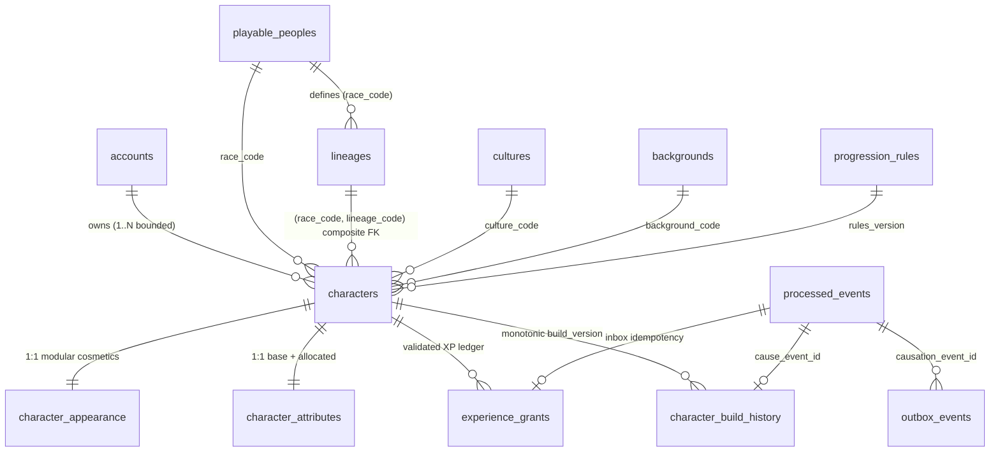

# CARBON — Character Engine Architecture & ER Model

## 1. Modelo de Domínio e Fronteiras de Identidade

O módulo `src/modules/characters/` implementa a persistência autoritativa da identidade jogável no ASCENDRA, separando explicitamente três conceitos:

1. **`Account` (`accounts`)**: identidade persistente da conta do usuário (`AccountID`, status `active | suspended | closed`, limite configurável de personagens, `external_subject` opcional; sem senhas em texto puro).
2. **`Character` (`characters`)**: avatar individual dentro do universo do jogo (`CharacterID` UUID estável), âncora futura para inventário, equipamentos, *Bounty* (+/-), fama, reputações regionais/faccionais, histórico criminal e títulos.
3. **`PlayerID` legado em `gameplay_contributions`**: identificador opaco recebido do NEON nas Sessions 01–02. **Não** foi criada relação retroativa artificial entre contribuições antigas e `characters`; a resolução futura ocorrerá na camada de sessão/autenticação traduzindo a conexão autenticada do jogador para `character_id` antes de despachar comandos ao NEON.

---

## 2. Diagrama Entidade-Relacionamento (Migrações `0004` e `0005`)

---

## 3. Sistema de Nomes (`src/modules/characters/domain/naming.ts`)

- Comprimento entre `3` e `24` code points Unicode após normalização `NFC`.
- Proibição estrita de caracteres de controle (`\p{Cc}`), formatação/invisíveis (`\p{Cf}`, zero-width, bidi overrides, soft-hyphen, Braille blank), dígitos, HTML/scripts e espaços nas extremidades ou separadores consecutivos.
- **Unicidade Canônica no Banco:** `canonical_name` aplica `NFKD`, remove marcas diacríticas combinantes (`\p{M}`) e converte para minúsculas, reforçado por `UNIQUE (canonical_name)` diretamente no PostgreSQL (protegendo contra corridas simultâneas sem depender de `SELECT` prévio).
- Bloqueio de nomes reservados e tentativas de personificação administrativa (`Admin`, `GM ...`, `Dev-...`, `Moderator`, `System`, `Ascendra`, `Carbon`, `Neon`) via interface local `NameModerationPolicy`.

---

## 4. Concorrência, Idempotência, Eventos e Segurança

- **Concorrência:**
  - `SELECT ... FROM accounts WHERE id = $1 FOR UPDATE` serializa criações simultâneas na mesma conta para respeitar `max_characters_per_account`.
  - `SELECT ... FROM characters WHERE id = $1 FOR UPDATE OF c` + guarda `expectedBuildVersion` (`UPDATE ... WHERE id = $6 AND build_version = $7`) e `UNIQUE (character_id, build_version)` impedem dupla alocação dos mesmos pontos ou corrupção entre *respec* e *level up* concorrentes.
- **Idempotência:** todos os comandos mutáveis reutilizam `processed_events` com fingerprint SHA-256 canônico (`fp:v1:<hex>`).
- **Eventos de Domínio no Outbox (`published_at = NULL`):** `CharacterCreated`, `CharacterAppearanceChanged`, `CharacterExperienceGranted`, `CharacterLevelUp`, `CharacterAttributesAllocated`, `CharacterAttributesReset` e `CharacterBuildChanged`.
- **Segurança:**
  - Verificação obrigatória de propriedade (`CharacterOwnershipForbiddenError`) antes de ler snapshot privado ou mutar personagem.
  - `grantExperience` exige `internal_system_authority` (rejeita contas de jogadores tentando autoconceder XP).
  - Isolamento absoluto contra persistência de estado temporário do modo *Genesis Ranked* (`GenesisTemporaryStatePersistenceForbiddenError`).
