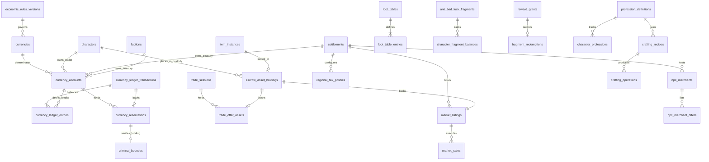

# CARBON Economy Engine (`src/modules/economy/`)

## 1. Visão Geral

O módulo `economy` implementa a fundação econômica persistente do ASCENDRA (Session 07), integrando moedas versionadas, carteiras e tesouros regionais, razão monetária de partidas dobradas (*double-entry ledger*), reservas financeiras (*escrow*), custódia física de equipamentos e materiais, comércio bilateral direto entre jogadores, mercado regional com preços livres e impostos versionados, comerciantes NPC controlados, loot individual de bosses, fragmentos anti-azar, liquidação verificada de recompensas criminais e motor de *crafting* com maestria de Ferraria.

> **Aviso de Escopo e Segurança:** Esta implementação opera em ambiente isolado de desenvolvimento sobre a base `origin/carbon/codex-independent-audit` (`d40c356`). A auditoria independente geral ainda possui verificações abertas (preservadas integralmente em `docs/audits/CARBON_CODEX_INDEPENDENT_AUDIT.md`), e os serviços não devem ser expostos diretamente em produção sem gateway de autenticação/transporte e *worker* do Outbox.

---

## 2. Diagrama Entidade-Relacionamento (Migrações `0013`–`0015`)

---

## 3. Fronteira Transacional Compartilhada (`PgEconomyTransactionScope`)

Para evitar *commits* intermediários entre carteira e inventário, `PgEconomyTransactionScope` (`src/modules/economy/infrastructure/postgres-economy-unit-of-work.ts`) encapsula um único `PgPoolClient` dentro de `BEGIN ... COMMIT`, compondo:
- `PgCharacterTransactionScope` (personagens e contas).
- `PgInventoryTransactionScope` (contêineres, `item_instances`, `inventory_stacks` e `item_operation_ledger`, sem duplicar regras da Session 04).
- `PgSocialTransactionScope` (reputação, `criminal_bounties`, `criminal_bounty_claims` e títulos declarativos).
- `claimOrVerifyProcessedEvent` (*Transactional Inbox*) e `outbox_events` (*Transactional Outbox*).

Se qualquer validação (saldo insuficiente, bolsa cheia, item vinculado, versão de oferta obsoleta ou conflito concorrente) falhar, **toda a transação PostgreSQL sofre `ROLLBACK` integral**.

---

## 4. Ordem de Locks Utilizada na Session 07

Todas as operações multi-domínio da Session 07 adquirem *row locks* `FOR UPDATE` na seguinte ordem determinística:

1. **Agregado Coordenador da Operação** (quando aplicável): `trade_sessions FOR UPDATE` / `market_listings FOR UPDATE` / `criminal_bounties FOR UPDATE` / `npc_merchants` + `npc_merchant_offers FOR UPDATE` (nenhum serviço das Sessões 01–06 trava `characters` antes dessas tabelas).
2. **Personagens Envolvidos:** `characters FOR UPDATE` ordenados por UUID ascendente (`ORDER BY id ASC`).
3. **Contas Proprietárias:** `accounts FOR UPDATE` ordenadas por UUID ascendente (`ORDER BY id ASC`).
4. **Transactional Inbox:** `claimOrVerifyProcessedEvent` em `processed_events` (após checagem de posse e status ativo).
5. **Carteiras e Reservas Monetárias:** `currency_accounts WHERE id = ANY($1) ORDER BY id ASC FOR UPDATE` (e `currency_reservations ORDER BY id ASC FOR UPDATE`).
6. **Contêineres de Inventário:** `ensureAndLockPrimaryContainers` em ordem ascendente do UUID do personagem dono.
7. **Ativos Físicos e Custódia:** `escrow_asset_holdings ORDER BY id ASC FOR UPDATE`, `item_instances FOR UPDATE` (ordenados por UUID) e `inventory_stacks ORDER BY id ASC FOR UPDATE`.
8. **Ledgers Append-Only e Outbox:** `INSERT` puros em `currency_ledger_transactions`, `currency_ledger_entries`, `item_operation_ledger`, `reward_grants`, `crafting_operations` e `outbox_events`.

---

## 5. Isolamento do Genesis Ranked

Todas as entradas públicas de carteira, reserva, comércio, mercado, NPC, loot, fragmentos, bounties e *crafting* invocam `assertNotGenesisContext(..., executionProfile)` no início da execução, impedindo que partidas temporárias MD3 do modo Genesis persistam moedas, equipamentos ou recursos no mundo aberto. O contrato efêmero futuro está documentado como proposta não persistente (`EphemeralGenesisMatchEconomyProposalV1` em `economy-types.ts`).
