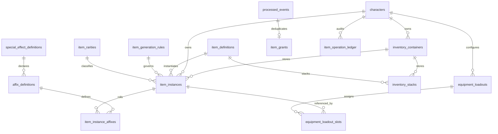

# CARBON Inventory Engine (`src/modules/inventory/`)

## 1. Visão Geral

O módulo `inventory` implementa o domínio persistente de itens, inventários, pilhas (*stacks*), equipamentos ativos, múltiplos *loadouts*, durabilidade, vinculação (*binding*), transferências entre personagens e razão contábil imutável (`item_operation_ledger`) do ASCENDRA.

Toda mutação ocorre em PostgreSQL real sob transações ACID explícitas (`PostgresInventoryUnitOfWork`), integrando-se a:
- **Transactional Inbox (`processed_events`):** idempotência por chave externa e detecção de conflitos semânticos via SHA-256 (`computeCanonicalFingerprintV1`).
- **Transactional Outbox (`outbox_events`):** emissão atômica de eventos de domínio (`ItemGranted`, `ItemMoved`, `ItemEquipped`, `ItemUnequipped`, `ItemStackSplit`, `ItemStacksMerged`, `ItemDurabilityChanged`, `ItemRepaired`, `ItemTransferred`, `ItemDestroyed`, `CharacterLoadoutChanged`, `CharacterBuildChanged`).
- **Character Engine (`characters`):** sincronização transacional de `build_version`, `snapshot_version`, `competitive_lock_state` e projeção `CharacterSnapshotV1`.

---

## 2. Diagrama Entidade-Relacionamento (Migrações `0006` e `0007`)

---

## 3. Containers Suportados e Invariantes de Slot

| Tipo (`container_type`) | Capacidade Padrão | Escopo |
|---|---|---|
| `character_inventory` | `40` slots (`0..39`) | Inventário principal do personagem (criado automaticamente e via *backfill* na migração `0007`). |
| `personal_storage` | `60` slots (`0..59`) | Baú pessoal persistente do personagem para organização entre containers. |

### Exclusividade Cruzada de Slot no Banco de Dados
Como um container pode armazenar tanto `item_instances` (equipamentos únicos) quanto `inventory_stacks` (recursos empilháveis), o PostgreSQL aplica simultaneamente:
1. Índice único parcial `uq_item_instances_container_slot` em `(container_id, container_slot_index) WHERE location_state = 'in_container'`.
2. Constraint `uq_inventory_stacks_container_slot` em `(container_id, container_slot_index)`.
3. Trigger `fn_enforce_container_slot_integrity` em ambas as tabelas, impedindo que uma instância e uma pilha ocupem o mesmo `(container_id, container_slot_index)`, validando `container_slot_index < capacity` e exigindo que `owner_character_id` coincida com o dono do container.

---

## 4. Operações Transacionais (`InventoryEngineService`)

- **`grantProceduralEquipment`:** Exclusivo para `internal_system_authority`. Gera instância única determinística, aplica política inicial de vinculação, aloca slot livre, grava `item_grants` (com proteção `UNIQUE (source_event_id, recipient_character_id, reward_slot_index)`), `item_operation_ledger` e `outbox_events`.
- **`grantStackableMaterial`:** Exclusivo para `internal_system_authority`. Preenche pilhas compatíveis existentes até `max_stack_size` e cria novas pilhas apenas para o excedente.
- **`splitStack` / `mergeStacks`:** Conservação estrita de quantidade (`nextSource + nextTarget === prevSource + prevTarget`), travando ambas as pilhas em ordem canônica de UUID (`lockStacksInCanonicalOrder`).
- **`moveInventoryEntry`:** Move instância ou pilha entre slots e entre `character_inventory` e `personal_storage`.
- **`equipItem` / `unequipItem` / `saveInactiveLoadout` / `activateLoadout`:** Gerenciam os 14 slots de combate, reserva de `off_hand` para armas `two_handed`, validação de requisitos intrínsecos e incremento de `build_version`/`snapshot_version`.
- **`applyDurabilityLoss` / `repairItem`:** Ajustam `current_durability` dentro de `[0, max_durability]` com auditoria no ledger.
- **`transferItemInstance` / `destroyItemInstance`:** Executam transferência atômica entre personagens (respeitando `binding_state`) ou destruição controlada, purgando ponteiros de *loadouts* inativos.

---

## 5. Limitações Atuais
- Containers de guilda, casas, fazendas e mercado global não fazem parte do escopo da Session 04, mas o modelo `(container_type, owner_character_id)` permite extensão futura sem reestruturar `item_instances`.
- Publicação assíncrona de `outbox_events` para o processo Go do NEON permanece desacoplada na tabela `outbox_events`.
