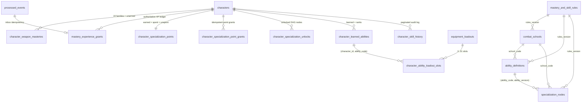

# CARBON — Skill Engine Architecture & ER Model (`src/modules/skills/`)

## 1. Visão Geral e Fronteira de Responsabilidade

O módulo `src/modules/skills/` governa a persistência autoritativa de:
- Regras versionadas de maestria, especialização e orçamento de build (`mastery_and_skill_rules`).
- Escolas de combate orientadas a dados (`combat_schools`).
- Definições imutáveis e versionadas de habilidades (`ability_definitions`).
- Grafos acíclicos direcionados (DAG) de especialização (`specialization_nodes`).
- Maestria individual por família de arma (`character_weapon_masteries`, `mastery_experience_grants`).
- Saldo conservado de pontos de especialização (`character_specialization_points`, `character_specialization_point_grants`).
- Aprendizado persistente, *ranks* e histórico (`character_learned_abilities`, `character_specialization_unlocks`, `character_skill_history`).
- Configuração de habilidades associada diretamente aos *loadouts* de equipamento (`character_ability_loadout_slots`).

> **Fronteira estrita CARBON <-> NEON:** O CARBON **não** executa *frame data*, *hitboxes*, *parry*, *cancels* nem fórmulas de dano em TypeScript. Cada habilidade carrega apenas metadados persistentes de elegibilidade, *rank* e uma referência simbólica versionada (`gameplay_effect_ref`) para execução futura pelo motor determinístico em Go do **NEON**.

---

## 2. Diagrama Entidade-Relacionamento (Migrações `0010` e `0011`)

---

## 3. Operações Transacionais (`SkillEngineService`)

| Operação | Autoridade Exigida | Modifica `BuildVersion`? | Modifica `SnapshotVersion`? | Eventos no Outbox |
| :--- | :--- | :---: | :---: | :--- |
| `grantWeaponMasteryExperience` | `internal_system_authority` | Não | Sim (se subir nível) | `WeaponMasteryExperienceGranted`, `WeaponMasteryLevelUp`*, `MasteryAchievementRecorded`* |
| `grantSpecializationPoints` | `internal_system_authority` | Não | Não | *(ledger interno + `character_skill_history`)* |
| `unlockSpecializationNode` | Dono ativo ou Sistema | Sim (`+1`) | Sim (`+1`) | `SpecializationNodeUnlocked`, `CharacterBuildChanged` |
| `learnAbility` | Dono ativo ou Sistema | Sim (`+1`) | Sim (`+1`) | `AbilityLearned`, `CharacterBuildChanged` |
| `upgradeAbilityRank` | Dono ativo ou Sistema | Sim (`+1`) | Sim (`+1`) | `AbilityRankIncreased`, `CharacterBuildChanged` |
| `equipAbility` | Dono ativo ou Sistema | Sim (loadout ativo) | Sim (loadout ativo) | `AbilityEquipped`, `CharacterBuildChanged`* |
| `unequipAbility` | Dono ativo ou Sistema | Sim (loadout ativo) | Sim (loadout ativo) | `AbilityUnequipped`, `CharacterBuildChanged`* |
| `saveLoadoutAbilities` | Dono ativo ou Sistema | Sim (loadout ativo) | Sim (loadout ativo) | `AbilityLoadoutChanged`, `CharacterBuildChanged`* |
| `resetSpecialization` | Dono ativo ou Sistema | Sim (`+1`) | Sim (`+1`) | `SpecializationReset`, `CharacterBuildChanged` |

---

## 4. Ordem Canônica de Locks (Prevenção de Deadlocks)

Para evitar *deadlocks* entre trocas de armas (`InventoryEngineService`), progressão de atributos (`CharacterEngineService`), desbloqueio de títulos (`SocialEngineService`) e mutações de habilidades (`SkillEngineService`), todos os fluxos obedecem à mesma ordem estrita:
1. `characters` (`SELECT ... FROM characters WHERE id = $1 FOR UPDATE OF c` — em ordem lexicográfica de UUID quando há dois personagens).
2. `equipment_loadouts` (`FOR UPDATE`).
3. `character_specialization_points` (`FOR UPDATE`).
4. `character_weapon_masteries` (`ORDER BY weapon_family_code ASC FOR UPDATE`).
5. `character_specialization_unlocks` e `character_learned_abilities` (`ORDER BY code ASC FOR UPDATE`).
