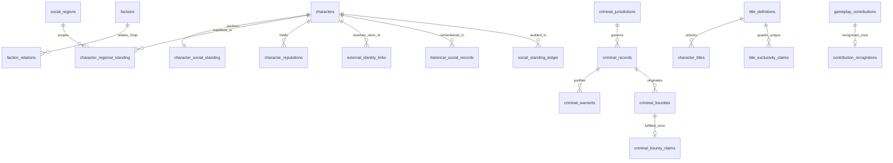

# CARBON Social Standing Engine (`src/modules/social/`)

## 1. Arquitetura e Separação de Domínios

O motor social do CARBON modela sete domínios persistentes ortogonais ancorados em `CharacterID`:
1. **Moral Bounty (`moral_bounty` / `moral_band`):** Histórico moral assinado (`BIGINT`) com 11 faixas e histerese.
2. **Fame (`global_fame` / `regional_fame`):** Grau de notoriedade pública ou criminal (`BIGINT >= 0`).
3. **Contextual Reputation (`character_reputations`):** Opinião esparsa por `faction`, `settlement` ou `region`.
4. **Criminal Record & Jurisdictions (`criminal_records`, `criminal_warrants`):** Infrações confirmadas/suspeitas e ordens de captura por jurisdição.
5. **Criminal Bounty (`criminal_bounties`, `criminal_bounty_claims`):** Contratos de captura/derrota com compromisso econômico explícito (`pending_economy_settlement`).
6. **Titles (`title_definitions`, `character_titles`, `title_exclusivity_claims`):** Conquistas permanentes, condicionais e exclusivas.
7. **World Recognition & Historical Memory (`historical_social_records`):** Crônicas de acontecimentos e classificador contextual para NPCs do NEON.

---

## 2. Diagrama Entidade-Relacionamento (Migrações `0008` e `0009`)

---

## 3. Identidade Social e Vínculo `PlayerID <-> CharacterID`

- Todas as tabelas sociais utilizam `character_id UUID REFERENCES characters(id)` como identidade primária.
- Para eventos vindos da simulação Go (`gameplay_contributions.player_id`), `external_identity_links` registra associações autoritativas explícitas `(source_namespace, external_subject_id) -> character_id` com índice único parcial `uq_external_identity_active_subject WHERE link_status = 'active'` e auditoria em `external_identity_link_history`.
- **Proibição de inferência frágil:** contribuições legadas nunca são associadas retroativamente por semelhança de nome; sem vínculo ativo, `recognizeEligibleContribution` falha explicitamente com `ExternalIdentityUnresolvedError`.

---

## 4. Concorrência, Eventos e Anti-Exploit

- **Ordem Canônica de Locks:** `SELECT ... FOR UPDATE` em ordem lexicográfica ascendente de UUIDs de personagens e bloqueio primário da linha de `criminal_bounties` antes de validar reivindicações concorrentes.
- **Prevenção de Abuso Social:** bloqueio de *farming* entre personagens da mesma `AccountID` (`SAME_ACCOUNT_FARMING_BLOCKED`), *cooldown* configurável (`anti_abuse_cooldown_seconds`), limite por janela (`anti_abuse_max_events_per_window`) e retornos decrescentes (`applyDiminishingReturnsBigInt`).
- **Eventos no Outbox (`published_at = NULL`):** `MoralStandingAdjusted`, `FameGranted`, `ReputationAdjusted`, `CrimeRecorded`, `WarrantIssued`, `WarrantResolved`, `CriminalBountyCreated`, `CriminalBountyClaimed`, `HeroicAchievementRecorded`, `TitleUnlocked`, `TitleRevoked`, `TitleEquipped` e `HistoricalRecordCreated`.
