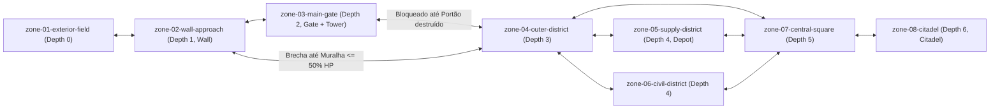

# Settlement Layout & Deterministic Zone Graph (`internal/siege/layout.go`)

## 1. Modelo Espacial: Grafo Determinístico de Zonas Conectadas

O modelo tático anterior utilizava posições escalares 1D (`WorldUnits`, `1000 = 1.000 tile`). Sem fingir física 2D completa ou navmesh, o Ciclo 05 introduz um **grafo determinístico de zonas conectadas**, extensível para coordenadas `(X, Y)` futuras via `PositionHint` escalar compatível com a percepção 1D da IA existente (`internal/ai`).

### Layout Provisório Padrão (`layout-valewatch-bastion` / `layout-ironford-citadel`)

> **Aviso de fixture provisória:** enquanto o CARBON ainda não fornecer geometria/estruturas persistentes de cidades via contrato aprovado, os layouts padrão abaixo são configurações locais explicitamente provisórias em [layout.go](../../internal/siege/layout.go) cuja soma exata de HP corresponde a `ports.SettlementSnapshot.MaxDefenseHP` (`1000` para `settlement-valewatch`, `1500` para `settlement-ironford`).

---

## 2. Regras de Acessibilidade e Anti-Teletransporte

Cada `ZoneConnection` possui uma regra explícita (`ConnectionRule`):
- `ConnAlwaysOpen`: livre para defensores e invasores.
- `ConnRequiresStructureCompromised`: bloqueada para invasores enquanto `BlockerStructureID` estiver `Intact` ou `Damaged`; liberada imediatamente quando a estrutura atinge `StructureBreached` (ex.: Muralha `<= 50%` HP) ou `StructureDestroyed` (`HP == 0`). Defensores podem atravessar portões intactos da própria cidade.
- `ConnDefenderOnly`: passagem restrita exclusivamente a defensores.

### Invariantes de Movimento
1. **Zero teletransporte:** `CanTraverse(state, from, to, isInvader)` rejeita qualquer salto direto entre zonas não conectadas ou bloqueadas (`ErrZoneBlocked`).
2. **Navegação determinística por etapas:** `NextStepToward(state, from, to, isInvader)` executa BFS lexicográfico determinístico respeitando regras de travessia; invasores deslocam-se fisicamente até o `PositionHint` da próxima zona antes de alterar seu `ZoneID`.
3. **Zona única por grupo:** cada `CreatureGroup` possui exatamente um `ZoneID`, tornando impossível que um único grupo capture múltiplos distritos simultaneamente.

---

## 3. Validação Antecipada de Layouts (`ValidateLayout`)

`ValidateLayout(layout, cfg)` rejeita antecipadamente:
- IDs vazios, acima de `MaxIdentifierLength` ou duplicados (zonas, conexões, estruturas, objetivos, defensores NPCs);
- Conexões self-loop ou referenciando zonas/estruturas bloqueadoras inexistentes;
- Ausência de zona `ZoneExteriorField`, zona `ZoneCitadel` ou estrutura `StructureCitadel`;
- Cidadela topologicamente inalcançável a partir do campo exterior (`ZoneHopDistance < 0`);
- Ciclos em `PrerequisiteIDs` de objetivos estratégicos;
- Violações dos limites `MaxZones`, `MaxConnections`, `MaxStructures`, `MaxObjectives` e `MaxNPCDefenders`.
