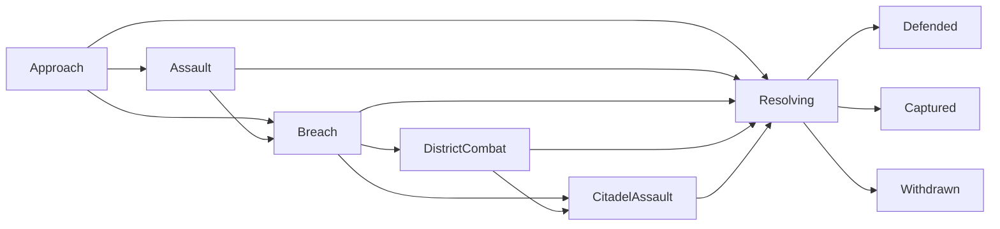

# Invasion, Siege & Settlement Battle Engine (`internal/siege`) — Cycle 05

Este documento descreve a arquitetura determinística de cercos, batalhas estruturadas em cidades fortificadas, defesa cooperativa, ocupação e preparação para reconquista do **ASCENDRA** (NEON — Cycle 05).

---

## 1. Visão Arquitetural e Autoridade Tática Única

O **Siege Engine** integra-se ao ecossistema existente preservando estritamente a separação de responsabilidades e uma única fonte de verdade:

```text
Ecosystem Engine (internal/ecosystem)
  └─ Populações (Free + Reserved + Materialized), acampamentos, recursos, ameaça, reservas sequenciais
          │
          ▼
World Event Director (internal/worldevents)
  └─ Campanhas (Goblin/Orc/Reconquest), escalonador, filas confirmáveis, ondas via reservas, ocupação
          │  (DirectorCommands — NENHUMA lógica de combate em worldevents)
          ▼
Tactical World Engine (internal/world)  ◄── ÚNICA AUTORIDADE TÁTICA
  ├─ Creature AI Engine (internal/ai)   ── Percepção, moral, coordenação O(G log G), perfis Goblin/Orc
  └─ Siege Engine (internal/siege)      ── Grafo de zonas, fortificações, brechas, distritos, objetivos,
                                           suprimentos táticos, reparação, fases, comandantes e ondas
```

- **Sem dupla autoridade:** `internal/siege` fornece regras puras, estruturas de dados, validadores e avaliadores determinísticos; **apenas `world.Step`** muta `WorldState`, executa comandos e invoca `resolveInvasion` uma única vez ao término do cerco.
- **Fonte única de verdade para integridade defensiva:** enquanto `WorldState.Siege != nil`, `WorldState.SettlementMaxDefenseHP == Siege.TotalStructureMaxHP()` e `WorldState.SettlementDefenseHP == Siege.TotalStructureHP()` são sincronizados atomicamente e verificados em `WorldState.Validate()`.
- **Compatibilidade total com Ciclos 01–04:** quando `WorldState.Siege == nil`, `world.Step` mantém 100% do comportamento anterior, preservando integralmente os 24 cenários dos Ciclos 01–04.

---

## 2. Fases do Cerco (`siege.SiegePhase`)

Separação estrita entre níveis de ciclo de vida:
- `worldevents.CampaignState`: ciclo estratégico da campanha mundial (`Candidate -> ... -> Active -> Resolving -> Defended/Captured -> Recovering -> Completed`).
- `world.InvasionState`: ciclo da arena tática (`Peace -> Threatened -> UnderAttack -> Resolved`).
- `siege.SiegePhase`: fases internas do combate durante `InvasionUnderAttack`:



| Fase | Entrada | Saída / Consequência |
|---|---|---|
| `Approach` | Início do cerco (`StartedTick`) | Avança para `Assault` quando invasores chegam a `WallApproach`/`MainGate`, ou `Breach`/`Resolving` |
| `Assault` | Invasores pressionando portão/muralha | Avança para `Breach` ao comprometer Portão ou Muralha (`HasOuterBreach()`), ou `Resolving` |
| `Breach` | Primeira brecha externa aberta | Destrava distritos internos e objetivos pós-brecha; avança para `DistrictCombat` ou `CitadelAssault` |
| `DistrictCombat` | Invasores operando em distritos internos (`Depth >= 3`) | Disputa territorial e interrupção de suprimentos; avança para `CitadelAssault` ao alcançar a Cidadela |
| `CitadelAssault` | Invasores na zona `ZoneCitadel` | Assalto final à Cidadela; defensores NPCs reagrupam na Cidadela |
| `Resolving` | Condição terminal satisfeita | Transiciona atomicamente no mesmo tick para `Defended`, `Captured` ou `Withdrawn` e dispara `world.resolveInvasion` |
| `Defended` | Todos os invasores eliminados e 0 ondas pendentes | Mapeia para `ports.InvasionOutcomeDefended` |
| `Withdrawn` | Colapso de moral coletiva (Goblin/Orc) ou política anti-stall (`NoProgressTimeoutTicks` / `SiegeMaxDurationTicks`) | Mapeia para `ports.InvasionOutcomeDefended` preservando `SiegePhase: "Withdrawn"` internamente (compatível com contratos CARBON) |
| `Captured` | Brecha externa confirmada **e** (`Citadel.HP == 0` **ou** `ZoneCitadel == InvaderControlled`) | Mapeia para `ports.InvasionOutcomeCaptured`, registra `OccupationRecord` e agenda `EventReconquestIntent` |

---

## 3. Ocupação e Fundação para Reconquista

Quando um cerco termina em `PhaseCaptured`:
1. `DirectorState.OccupiedSettlements` registra um `siege.OccupationRecord` imutável (ordenado por `SettlementID`, limitado por `MaxCompletedHistory`) preservando `OccupyingFactionID`, `CapturedCampaignID`, `CapturedInvasionID`, `CapturedTick`, `StructuresDestroyed`, `DistrictsCaptured` e `ReconquestPlanned`.
2. O fato global `TerminalSettlementOutcome` é emitido estritamente uma vez — **mesmo com 0 jogadores elegíveis** — carregando as extensões opcionais de cerco (`SiegePhase`, `StructuresDestroyed`, `DistrictsCaptured`, `InvaderCasualties`, `DefenderCasualties`, `IsReconquest`) sem modificar `internal/ports/carbon.go`.
3. Uma reconquista simplificada utiliza a **mesma** infraestrutura `SiegeEngine` sob uma nova campanha com `IsReconquest: true`, novo `CampaignID` monotônico e novo `InvasionID` monotônico (jamais reutilizando IDs anteriores), limpando o `OccupationRecord` após a liberação.
4. Persistência em banco, troca de governo, economia de reconstrução, reputação e títulos permanecem integralmente sob responsabilidade do **CARBON**.

---

## 4. Limites Operacionais (`siege.Config`) e Escopo de Arena

| Limite | Default | Finalidade |
|---|---:|---|
| `MaxZones` / `MaxConnections` | `16` / `32` | Teto do grafo topológico de zonas |
| `MaxStructures` / `MaxObjectives` | `16` / `16` | Teto de fortificações e objetivos |
| `MaxWaves` / `MaxCommanders` / `MaxNPCDefenders` | `8` / `4` / `16` | Teto de ondas, comandantes e guarnição NPC |
| `MaxSupplies` / `MaxSupplyRegenTotal` | `500` / `100` | Recursos táticos finitos (proíbe reparação infinita) |
| `MaxRepairsPerStructure` / `MaxRepairsPerEntity` | `6` / `4` | Teto de reparos por estrutura e por entidade |
| `NoProgressTimeoutTicks` / `SiegeMaxDurationTicks` | `160` / `480` | Prevenção determinística de cercos infinitos |

> **Escopo explícito:** a arquitetura atual suporta **1 arena tática ativa simultânea** por simulação. Múltiplas arenas paralelas pertencem a ciclos futuros.
