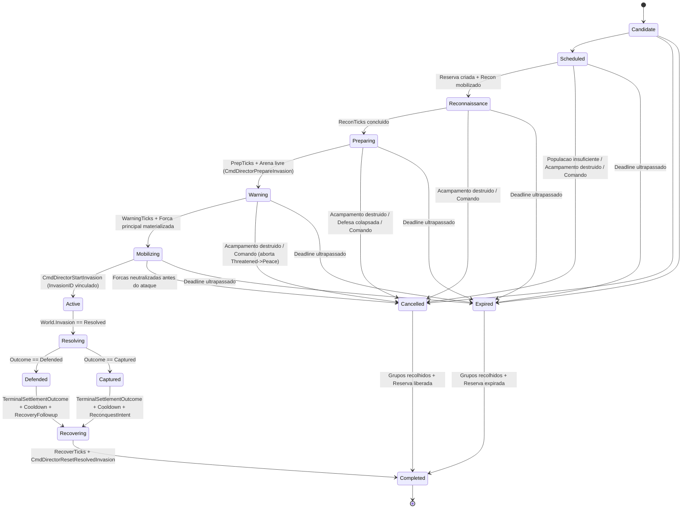

# Campaign Engine — ASCENDRA (NEON Cycle 04)

## 1. Máquina de Estados Explícita de Campanha (`CampaignState`)

Todas as transições passam obrigatoriamente por `ValidateCampaignTransition(from, to)` em `internal/worldevents/campaigns.go`. Saltos arbitrários, cancelamento após início do combate (`Active`) e reexecução de campanhas terminais são rejeitados com `ErrInvalidCampaignTransition`.

## 2. Políticas Data-Driven: Goblins vs Orcs (`internal/worldevents/policy.go`)

Ambos os perfis compartilham a mesma infraestrutura de campanhas, diferindo puramente por dados em `CampaignPolicyTemplate`:

| Parâmetro | `goblin-raid-campaign` (Goblins) | `orc-warband-campaign` (Orcs) |
|---|---|---|
| `EventKind` | `GoblinRaidCampaign` | `OrcWarbandCampaign` |
| `Family` | `goblin` | `orc` |
| `MinFreePopulation` | `45` | `65` |
| `MinThreatScore` | `350` | `500` |
| Cadência (`Recon / Prep / Warning / Recover`) | `6 / 8 / 6 / 18` ticks | `8 / 12 / 8 / 25` ticks |
| `DeadlineSlackTicks` | `80` ticks | `100` ticks |
| Cooldown (`Região / Assentamento`) | `55 / 45` ticks | `80 / 65` ticks |
| Reconhecimento | `1x goblin-skirmisher` (peso 4) | `1x orc-vanguard` (peso 4) |
| Força Principal (`MainForces`) | `1x goblin-raider-pack` (8) + `1x goblin-taskmaster` (5) | `1x orc-vanguard` (4) + `1x orc-berserker` (4) + `1x orc-warchief` (1) |
| Reforços Ecológicos | Até `2` ondas de `1x goblin-skirmisher` (buffer 8) | Até `2` ondas de `1x orc-vanguard` (buffer 8) |
| Contingente Total Reservado | `25` indivíduos | `21` indivíduos (unidades de elite) |
| Pesos de Prioridade (`Leadership / Territory`) | `80 / 100` | `220 / 180` |

## 3. Regra de Hostilidade e Facções Neutras/Aliadas

`EvaluateCandidates` e `validateDirectCandidate` exigem `faction.HostileToSettlement == true`. Facções neutras ou aliadas **nunca** iniciam campanhas de invasão contra o assentamento, independentemente de sua família ou tamanho populacional.

## 4. Cancelamento, Expiração e Proteção de Assentamento

- **Destruição de acampamento ou perda de hostilidade**: se o acampamento de origem deixa de satisfazer `CanSupplyMaterialization()` durante `Scheduled`, `Reconnaissance`, `Preparing`, `Warning` ou `Mobilizing`, `abortPreActiveCampaign` recolhe e reconcilia grupos já mobilizados (`RecallCampaignGroups` + `ReconcileReservationContingent`), libera o saldo não materializado (`CancelReservation`), aborta a preparação tática (`CmdDirectorAbortPreparedInvasion` se `Threatened`), e arquiva a campanha como `Completed`.
- **Regras de proteção (`Config`)**:
  - `ProtectedRegions`: bloqueia avaliação automática e comando direto (`ErrProtectedTarget`);
  - `MinSimulatedDefenseHP`: impede campanhas contra assentamento colapsado (default `200`);
  - `MinInvasionIntervalTicks`: piso mínimo de cooldown entre invasões no mesmo assentamento (default `40`);
  - `RequireAvailableDefenders`: opção para exigir defensores vivos antes de gerar candidatos.

## 5. Consequências Pós-Resolução e Eventos Encadeados Seguros

- **`Defended`**: reduz `RecentConflictScore` da região ofensora (até `-250`, piso `0`), aplica cooldown regional e de assentamento e agenda `EventRecoveryFollowup` com `ChainDepth = c.ChainDepth + 1` (se `< MaxChainDepth`).
- **`Captured`**: **nunca** dispara segunda invasão no mesmo tick; aplica cooldown regional/assentamento (`max(SettlementCooldownTicks, MinInvasionIntervalTicks)`) e agenda `EventReconquestIntent` após o cooldown com `ChainDepth = c.ChainDepth + 1` (se `< MaxChainDepth`).
- **Prevenção de loops infinitos**: `MaxChainDepth` (default `2`) e `MaxPendingEvents` (default `32`) limitam estritamente qualquer encadeamento, e `EventRecoveryFollowup` / `EventReconquestIntent` atuam como ganchos determinísticos sem re-encadeamento recursivo.

## 6. Reforços Ecológicos com Débito Populacional Real

No modo `OrchestrationCampaignDirector`:
- `world.Step` **nunca** cria reforços sem reserva para grupos vinculados (`PopulationWeight > 0`); em vez disso emite `world.EventReinforcementRequested`.
- `worldevents.Step` intercepta `EventReinforcementRequested` enquanto `World.Invasion.State == InvasionUnderAttack`, valida: campanha `Active`, `AllowEcologicalReinforcements`, `ReinforcementsDeployed < MaxCampaignReinforcements`, `Invasion.ReinforcementWaves < MaxReinforcementWaves`, `len(Groups) < MaxActiveGroups` e acampamento operacional.
- Somente se todas as condições passarem, o Diretor chama `ecosystem.MaterializeFromReservation` (debitando exatamente do buffer pré-reservado com `opKey = "reinf:<CampaignID>:<n>"`) e `world.SpawnCampaignReinforcement` com `NextDurableGroupID`. Caso o acampamento tenha sido destruído ou o buffer esgotado, o pedido é silenciosamente negado sem criar população fantasma.

## 7. Identificadores Duráveis e Arquivamento Limitado

- Identificadores monotônicos persistidos em snapshot e checksum: `CampaignSeq` (`cmp:<sim>:<seq>`), `ScheduledEventSeq` (`wev:<sim>:<seq>`), `OutcomeSeq` (`out:<sim>:<seq>`), `GroupSeq` (`grp:<sim>:<cmp>:<tag>:<seq>`), `InvasionSeq` (`<sim>-inv-<seq>`), `ReservationSeq` (`res:<sim>:<seq>`).
- Ao atingir `CampaignCompleted`, a campanha é resumida em `CompletedHistory` (anel FIFO limitado a `MaxCompletedHistory = 64`), removida de `Campaigns`, e reservas fechadas são podadas via `ecosystem.PruneClosedReservations`.
