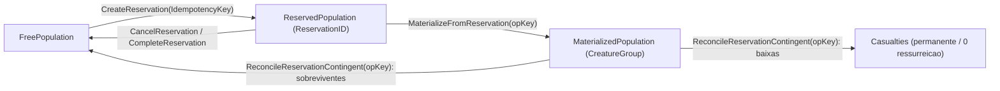

# Idempotent Population Reservations — ASCENDRA (NEON Cycle 04)

## 1. Motivação (Resolução do Achado P2 da Auditoria do Ciclo 03)

Na auditoria independente do Ciclo 03 (`NEON_CYCLE_03_AUDIT.md`, P2), apontou-se que os tickets agregados sem identidade (`ReserveForMaterialization` / `ReconcileDematerialization`) eram vulneráveis à reaplicação duplicada ou contaminação cruzada caso duas operações referenciem a mesma população simultaneamente.

No Ciclo 04, o ledger populacional passa a operar sobre **3 compartimentos conservados exatos** (`FreePopulation`, `ReservedPopulation`, `MaterializedPopulation`) governados por `PopulationReservation` em `internal/ecosystem/reservations.go`.

## 2. Invariantes Matemáticos de Conservação

Para toda população `P` e toda reserva `R` pertencente a `P`:

1. `FreePopulation >= 0`, `ReservedPopulation >= 0`, `MaterializedPopulation >= 0`;
2. `MaterializedAmount + ReleasedAmount <= ReservedAmount` (logo `RemainingReserved() >= 0`);
3. `ReturnedSurvivors + Casualties <= MaterializedAmount` (logo `RemainingMaterialized() >= 0`);
4. **Conservação de reserva** (`EcosystemState.Validate`):
   `sum_{R in P}(R.RemainingReserved()) == P.ReservedPopulation`;
5. **Conservação tática cross-layer** (`OrchestratedState.Validate`):
   `sum_{G ativo de P}(G.PopulationWeight) == P.MaterializedPopulation` e
   `sum_{G ativo de R}(G.PopulationWeight) == R.RemainingMaterialized()`;
6. **Zero ressurreição**: quando `defeated == true` ou `hpRemaining == 0`, `survivors = 0` e `losses = contingentSize`.

## 3. Operações e Garantias de Idempotência

| Função (`internal/ecosystem/reservations.go`) | Identidade / Chave | Comportamento em Repetição |
|---|---|---|
| `CreateReservation` | `ReservationID` monotônico (`res:<sim>:<seq>`) + `IdempotencyKey` | Mesmos parâmetros -> retorna reserva existente como no-op (`created=false`); parâmetros conflitantes -> `ErrReservationConflict`; chave já podada em `RetiredReservationKeys` -> `ErrDuplicateReservation`. |
| `MaterializeFromReservation` | `(ReservationID, opKey)` | Rejeita `opKey` repetido em `AppliedOps` com `ErrDuplicateReservationOp`; valida família, acampamento operacional e `RemainingReserved() >= weight`. |
| `ReconcileReservationContingent` | `(ReservationID, opKey)` | Rejeita `opKey` repetido com `ErrDuplicateReservationOp`; deduz `contingentSize` de `MaterializedPopulation`, devolve apenas sobreviventes vivos (`0` se derrotado) para `FreePopulation`; auto-fecha reserva como `ReservationCompleted` se `RemainingReserved == 0 && RemainingMaterialized == 0`. |
| `CancelReservation` | `ReservationID` | Libera **apenas** `RemainingReserved()` (nunca reverte tropas já materializadas ou mortas!); repetir após já cancelada/expirada com saldo `0` é no-op seguro retornando `0`; rejeita reserva já `Completed` com `ErrReservationClosed`. |
| `CompleteReservation` | `ReservationID` | Exige `RemainingMaterialized() == 0`; devolve saldo não usado (ex.: buffer de reforços não acionados) para `FreePopulation` e marca `ReservationCompleted`; repetir é no-op seguro. |
| `PruneClosedReservations` | `ReservationSeq` + `RetiredReservationKeys` | Poda reservas fechadas (`IsClosed() == true`) acima do teto retido, registrando `IdempotencyKey` no anel FIFO `RetiredReservationKeys` e mantendo `ReservationSeq` estritamente monotônico — qualquer `ReservationID` antigo/podado rejeita replay com `ErrUnknownReservation`. |

## 4. Isolamento entre Reservas Simultâneas

Duas reservas distintas (`R1`, `R2`) sobre a mesma população `P` possuem contadores independentes (`ReservedAmount`, `MaterializedAmount`, `ReleasedAmount`, `AppliedOps`). Cancelar ou expirar `R1` jamais libera ou afeta o saldo de `R2`.
