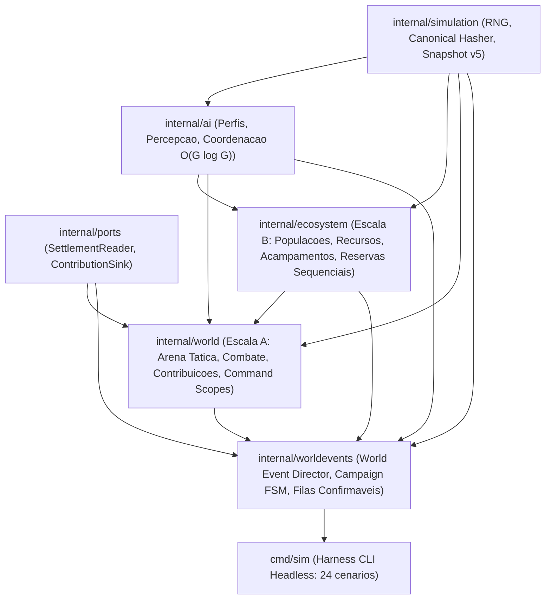

# World Event Director — ASCENDRA (NEON Cycle 04)

## 1. Visão Geral e Propósito

O **World Event Director** (`internal/worldevents`) é a camada orquestradora autoritativa do ASCENDRA responsável por transformar alterações ecológicas (populações, acampamentos, ameaça regional e disputas territoriais da Escala B — `internal/ecosystem`) em **campanhas dinâmicas e eventos mundiais jogáveis**, acionando a Escala A (`internal/world` + `internal/ai`) com **autoridade única sobre início de invasões** e **conservação exata de população em 3 compartimentos** (`Free + Reserved + Materialized`).

Ele NÃO substitui o motor de ecossistema, NÃO substitui o motor tático de combate/IA e NÃO implementa sistemas persistentes pertencentes ao CARBON (banco de dados, economia, inventário, reputação, Bounty, títulos ou reconstrução persistente).

## 2. Arquitetura em 3 Camadas (Grafo Acíclico)

### Regra de Autoridade Única de Invasões

| Modo (`world.OrchestrationMode`) | Uso | Quem inicia invasões (`Peace -> Threatened -> UnderAttack`) | Quem executa e resolve a batalha (`UnderAttack -> Resolved`) |
|---|---|---|---|
| `OrchestrationLegacyThreat` | Regressão dos Ciclos 01–03 | `world.Step` via limiares de `RegionalThreat` | `world.Step` |
| `OrchestrationCampaignDirector` | **Ciclo 04 (padrão em `OrchestratedConfig`)** | **EXCLUSIVAMENTE** `internal/worldevents` via `CmdDirectorPrepareInvasion` / `CmdDirectorStartInvasion` | **EXCLUSIVAMENTE** `internal/world` (`StepWithDirector`) |

No modo `OrchestrationCampaignDirector`, as transições automáticas por `RegionalThreat` em `world.Step` (incluindo o revert automático `Threatened -> Peace` por decaimento de ameaça) permanecem **desabilitadas**.

## 3. Separação Explícita de Comandos (`internal/world/commands.go`)

- **`GameplayCommand` (`ScopeGameplay`)**: exclusivamente intenções de jogadores (`CmdDeployDefender`, `CmdPlayerDefendStrike`, `CmdPlayerSupportDefense`, `CmdCompleteObjective`). Qualquer tentativa de enviar comando administrativo ou de diretor por este limite retorna `world.ErrUnauthorizedCommand` sem mutar estado.
- **`DirectorCommand` (`ScopeDirector`)**: exclusivamente diretivas orquestradoras emitidas pelo World Event Director (`CmdDirectorPrepareInvasion`, `CmdDirectorStartInvasion`, `CmdDirectorSpawnCampaignGroup`, `CmdDirectorResetResolvedInvasion`, `CmdDirectorAbortPreparedInvasion`).
- **`AdminCommand` (`ScopeAdmin`)**: exclusivamente fixtures e testes administrativos (`CmdIncreaseThreat`, `CmdSpawnHostileGroup`, `CmdForceInvasionTransition`), rejeitado tanto em `StepGameplay` quanto em `StepWithDirector`.

## 4. Pipeline Determinístico por Tick (`worldevents.Step`)

A função `worldevents.Step(state, input, cfg)` é **pura, sem I/O, sem `time.Now()`, sem ponto flutuante e estritamente atômica** (qualquer erro deixa `state` intacto):

1. Valida `OrchestratedState` e `OrchestratedConfig`, verifica overflow de `Tick` e rejeita comandos ecológicos fora de ticks de fronteira de epoch (`nextTick % TicksPerEpoch != 0`).
2. Limpa cooldowns expirados (`ReadyAtTick <= nextTick`) garantindo crescimento `O(1)` em memória.
3. Em ticks de epoch, executa `ecosystem.StepEpoch` **antes** da avaliação do diretor para que acampamentos destruídos ou colapsos populacionais afetem imediatamente campanhas em preparação.
4. Aplica `DirectorCommand` explícitos (`DirCmdScheduleCampaign`, `DirCmdCancelCampaign`) em ordem canônica.
5. Em intervalos `CandidateEvalIntervalTicks`, executa `EvaluateCandidates` (filtrando exclusivamente facções `HostileToSettlement == true`, regras de proteção de assentamento, cooldowns e acampamentos operacionais) e enfileira candidatos no escalonador.
6. Executa `processScheduler` (expiração por deadline, envelhecimento anti-starvation, priorização determinística + desempate canônico e limites de concorrência) e instancia novas campanhas.
7. Executa `advanceCampaigns` (reservas idempotentes, mobilização de reconhecimento e força principal, aborto seguro em caso de destruição de acampamento ou deadline, aviso ao assentamento, disparo do assalto, recuperação e arquivamento).
8. Executa `world.StepWithDirector` com `GameplayCommands` + `DirectorCommands`.
9. Reconcilia grupos táticos recém-mortos/dispersos estritamente uma vez via `ecosystem.ReconcileReservationContingent` (`opKey = "term:" + groupID`).
10. Processa `world.EventReinforcementRequested` exclusivamente debitando do buffer reservado da campanha via `ecosystem.MaterializeFromReservation` + `world.SpawnCampaignReinforcement` (se o acampamento foi destruído ou o limite de ondas/grupos foi atingido, nega sem criar população fantasma).
11. Finaliza campanhas resolvidas (`Active -> Resolving -> Defended|Captured -> Recovering`), emite `TerminalSettlementOutcome` **estritamente uma vez** (mesmo com `EligibleContributors == 0`), aplica consequências ecológicas, cooldowns e agenda follow-ups com profundidade limitada (`MaxChainDepth`).
12. Revalida todos os invariantes intra-camada e cross-layer antes de retornar o novo `OrchestratedState`.

## 5. Fato Global Autoritativo com Zero Jogadores

`TerminalSettlementOutcome` é emitido pelo Diretor sempre que uma invasão ligada a campanha atinge `InvasionResolved`, contendo `EventID`, `SimulationID`, `CampaignID`, `InvasionID`, `SettlementID`, `RegionID`, `InvadingFactionID`, `Outcome` (`Defended` ou `Captured`), `StartedTick`, `CompletedTick`, `RulesVersion` e `EligibleContributors`.

Quando nenhum jogador participa (`0` defensores e `0` comandos de gameplay), o fato global continua sendo emitido estritamente uma vez com `EligibleContributors == 0`, evitando perda silenciosa de captura/defesa de cidades pelo mundo aberto.

## 6. Snapshots v5 e Validação Cross-Layer

`simulation.SnapshotVersion = 5` persiste as três camadas e as três filas confirmáveis (`PendingDirectorBatches`, `PendingOutcomes`, `PendingContributions` + cursores de confirmação) sob um único checksum canônico SHA-256, com enforcement pré-decodificação de `MaxSnapshotBytes`. Versões anteriores (`v1`–`v4`) e reservas legadas arbitrárias são explicitamente rejeitadas; veja [BACKPRESSURE_AND_RECOVERY.md](BACKPRESSURE_AND_RECOVERY.md).

Na restauração (`UnmarshalOrchestratedSnapshot`), `OrchestratedState.Validate` garante:
- `Director.Tick == World.Tick`;
- Todas as filas confirmáveis têm sequências contíguas, `AckSeq <= Seq`, sem duplicatas nem ticks futuros;
- Toda campanha `Active` corresponde exatamente ao `World.Invasion` ativo/resolvido com mesmo `CampaignID`;
- Toda campanha com `ReservationID` aponta para uma reserva sequencial existente, única e com proveniência idêntica;
- Todo grupo tático não contabilizado com `PopulationWeight > 0` bate exatamente com `pop.MaterializedPopulation` e `res.RemainingMaterialized()`;
- `sum(res.RemainingReserved()) == pop.ReservedPopulation` para toda população.
